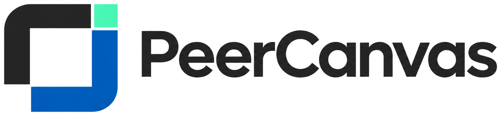

<h1 align="center">
  
</h1>

<p align="center"><strong>A local-first desktop workspace for diagrams and collaborative thinking.</strong></p>

<p align="center">
  <a href="#project-status">Status</a>
  ·
  <a href="#getting-started">Getting started</a>
  ·
  <a href="PLANS.md">Roadmap</a>
  ·
  <a href="docs/architecture/overview.md">Architecture</a>
  ·
  <a href="docs/handoff/START_HERE.md">Handoff</a>
</p>

PeerCanvas is an open-source desktop diagram editor for turning ideas into architecture, UML, BPMN, network, cloud, database, process, and workflow diagrams. The goal is a useful local editor that works without a network connection or an AI account, with optional peer collaboration, draw.io interchange, and Codex/MCP assistance.

The project is in early development. S0–S2 are complete on `main`; S3 is complete on `dev`. S3 adds a licensed offline shape catalog, safe SVG previews, schema-v2 catalog references, and local draw.io import/export for a declared subset. Full draw.io parity is not claimed. The delivery board records sprint and promotion status.

## Project status

**S0–S2 are complete on `main`; S3 is complete on `dev`.** S3 includes one reviewed first-party rectangle preview, a versioned shape reference on inserted nodes, and a tested draw.io subset with loss reports and safe source-fragment preservation. The renderer compatibility gate passed its bounded native fixture on Windows, macOS, and Linux; that evidence does not establish full native product support.

| Area                                            | Current state                                                                                                                                               |
| ----------------------------------------------- | ----------------------------------------------------------------------------------------------------------------------------------------------------------- |
| Core editing                                    | In-memory add, select, move, resize, and delete. [WP-04.1 / #25](https://github.com/furancho-labs/Peer2Canvas/issues/25) is merged into `dev`.              |
| Connectors, properties, pages/layers, undo/redo | Included in the current S2 code under [WP-04.2 / #26](https://github.com/furancho-labs/Peer2Canvas/issues/26).                                              |
| Local files and recovery                        | S2 adds `.peercanvas` Save, Save As, Open, Reopen last, migration, unsaved-change protection, and backup recovery; native UI evidence is recorded on macOS. |
| Shape catalog and draw.io interchange           | WP-05 and WP-06 are complete on `dev`; the catalog, safe SVG previews, schema-v2 references, and declared draw.io subset are implemented.                   |
| Peer collaboration                              | Planned around Yjs and Trystero/WebRTC; network behavior is unverified.                                                                                     |
| Codex and MCP                                   | Optional integrations researched; not implemented.                                                                                                          |

WP-05 and WP-06 are complete on `dev`. Local checks pass 231 TypeScript tests and 33 Rust tests, typecheck, lint, formatting, Clippy, the optimized Rust check, and OpenSpec validation. PR [#125](https://github.com/furancho-labs/Peer2Canvas/pull/125) passed all eight required checks, CodeQL, OSV, Gitleaks, and native jobs. A local macOS bundle attempt could not generate the configured app icon, so native file-dialog interaction remains unverified. See the [platform matrix](docs/support/platform-matrix.md) and [handoff](docs/handoff/START_HERE.md) for the scope of each result.

The [PeerCanvas Delivery Board](https://github.com/users/VforVitorio/projects/4) groups work by parent work-package issues, task sub-issues, and sprint milestones. WP-05/#5 and its children #27–#29, plus WP-06/#7 and its children #30–#34, are closed and Done on the board. S3 milestone #4 records sprint closeout. Grouping is a separate S9 item under [WP-14/#91](https://github.com/furancho-labs/Peer2Canvas/issues/91), with discovery in [#89](https://github.com/furancho-labs/Peer2Canvas/issues/89).

## What the editor is being built for

- **Think visually:** create and connect diagram elements, inspect properties, organize pages and layers, and reverse accepted changes.
- **Keep local work independent:** core editing must remain usable without peers, a provider account, or a hosted service.
- **Collaborate when needed:** optional temporary peer sessions are planned, with explicit permissions and visible connection failures.
- **Exchange diagrams:** draw.io import/export will target a documented compatibility subset with loss reporting.
- **Use assistance with control:** optional Codex/MCP tools will propose changes for preview and approval before applying them.

The [product definition](docs/requirements/product-definition.md) records requirements and use cases. [PLANS.md](PLANS.md) tracks work packages, dependencies, and sprint exit evidence.

## Getting started

Development requires Node.js 24, the stable Rust toolchain, and the platform dependencies listed in the [Tauri prerequisites](https://v2.tauri.app/start/prerequisites/).

```sh
git clone https://github.com/furancho-labs/Peer2Canvas.git
cd Peer2Canvas
npm ci
npm run tauri -- dev
```

Run the frontend alone with `npm run dev`. Build the native application without an installer with `npm run tauri -- build --no-bundle`.

### Separate UI demonstration

```sh
npm run ui:mock
```

Open `http://127.0.0.1:1430/`. This review surface uses fictional data and simulated file, recovery, interchange, participant, assistant, and MCP outcomes. Nothing is saved or sent. Fixtures and success/wait/cancel/error scenarios can be changed from the banner; Reset demo starts again and preferences are temporary.

`npm run build:ui-mock` writes `dist-ui-mock/` separately from the normal application build. See [demo evidence and limitations](docs/development/ui-mock.md).

## Architecture

| Layer         | Direction                                                                                                                                                    |
| ------------- | ------------------------------------------------------------------------------------------------------------------------------------------------------------ |
| Desktop shell | Tauri 2 and Rust, hosting React 18, TypeScript, and Vite.                                                                                                    |
| Canvas        | The official Weave.js renderer, with selected composition adapted from `weavejs-frontend`. The example app's TanStack Start runtime is not adopted.          |
| Document      | One canonical, versioned model. UI edits pass through validated commands; Weave holds a disposable rendering projection.                                     |
| Persistence   | A versioned `.peercanvas` JSON file is the durable document; a Rust adapter owns native dialogs, safe writes, and recovery. Preferences stay separate.       |
| Collaboration | Yjs synchronization with a replaceable Trystero/WebRTC transport is proposed. Signaling relays or TURN may be needed; direct connectivity is not guaranteed. |
| Assistant     | A planned provider boundary and Codex app-server integration. The chat UI will adapt the shadcn chatbot template while keeping the Tauri/Vite structure.     |

The shadcn template's Next.js routes and Vercel AI SDK backend are outside the planned stack. Current authentication research and implementation gates are documented in [Codex integration](docs/architecture/codex-integration.md).

## Development and checks

```sh
npm run format:check
npm run lint
npm run typecheck
npm test
npm run build
cargo fmt --manifest-path src-tauri/Cargo.toml --check
cargo test --manifest-path src-tauri/Cargo.toml
cargo clippy --manifest-path src-tauri/Cargo.toml --all-targets -- -D warnings
```

GitHub Actions checks the frontend, native builds, and the separate S0 renderer probe on Ubuntu, macOS, and Windows. Run the test-only native compatibility probe on a desktop runner with:

```sh
npm run native-smoke:build
npm run native-smoke
```

The probe uses a temporary in-memory fixture. Its passing result does not verify product save/open, deep links, peer connectivity, or full editor workflows.

Contributions follow `feature/*` → `dev` → `main`. Focused task PRs target `dev`, close their child issue, and reference the parent work package; completed sprint batches are promoted to stable `main`. Product behavior lives in OpenSpec, execution in GitHub Issues, and sprint sequencing in [PLANS.md](PLANS.md). Read [CONTRIBUTING.md](CONTRIBUTING.md) and [AGENTS.md](AGENTS.md) before making changes.

## Documentation

| Start here                                                                                            | Details                                                         |
| ----------------------------------------------------------------------------------------------------- | --------------------------------------------------------------- |
| [Product definition](docs/requirements/product-definition.md)                                         | Requirements, actors, use cases, and boundaries.                |
| [Architecture](docs/architecture/overview.md)                                                         | Component responsibilities, decisions, and validation gates.    |
| [Roadmap](PLANS.md)                                                                                   | Working packages, dependencies, estimates, and sprint sequence. |
| [OpenSpec](openspec/changes/peer-canvas-foundation/)                                                  | Capability contracts and implementation tasks.                  |
| [Issue map](docs/planning/subissue-map.md)                                                            | Task-to-issue traceability.                                     |
| [GitHub workflow](docs/planning/github-workflow.md)                                                   | Branch protection, CI, and repository rules.                    |
| [Quality strategy](docs/quality/TEST_STRATEGY.md) and [risk register](docs/security/RISK_REGISTER.md) | Verification layers, release gates, and open risks.             |
| [Brand guide](docs/branding/brand-guide.md)                                                           | Maintainer-supplied assets, usage, and rights.                  |
| [Session handoff](docs/handoff/START_HERE.md)                                                         | Current checkpoint, evidence, and next task.                    |

## Acknowledgments and third-party notices

The following projects inform the implementation and roadmap. Adopted sources, revisions, licenses, and retained notices are recorded in [THIRD_PARTY_NOTICES.md](THIRD_PARTY_NOTICES.md). The direct/transitive license snapshot for the locked npm and Cargo dependency graphs is in [the dependency inventory](LICENSES/dependency-inventory-2026-11.csv).

| Project or documentation                                                                                                                                            | Use in PeerCanvas                                                           |
| ------------------------------------------------------------------------------------------------------------------------------------------------------------------- | --------------------------------------------------------------------------- |
| [Tauri](https://v2.tauri.app/)                                                                                                                                      | Desktop shell and native integration.                                       |
| [Weave.js](https://github.com/InditexTech/weavejs) and [weavejs-frontend](https://github.com/InditexTech/weavejs-frontend)                                          | Renderer and selected frontend composition under Apache-2.0.                |
| [OpenPencil](https://github.com/open-pencil/open-pencil)                                                                                                            | Peer-collaboration architecture reference.                                  |
| [Yjs](https://docs.yjs.dev/) and [Trystero](https://trystero.dev/)                                                                                                  | Proposed document synchronization and WebRTC transport.                     |
| [draw.io](https://github.com/jgraph/drawio)                                                                                                                         | Interchange target and file-format reference.                               |
| [OpenSpec](https://github.com/Fission-AI/OpenSpec)                                                                                                                  | Specification workflow.                                                     |
| [shadcn chatbot template](https://github.com/shadcn-ui/chatbot-template)                                                                                            | Planned MIT-licensed chat UI reference; no template source has been copied. |
| [OpenAI Sign in with ChatGPT and Codex app-server docs](https://developers.openai.com/siwc/token-sharing-open-source)                                               | Optional subscription-authentication research.                              |
| [t3code](https://github.com/pingdotgg/t3code), [CodexMonitor](https://github.com/Dimillian/CodexMonitor), and [CodexGui](https://github.com/wieslawsoltes/CodexGui) | Public examples reviewed for Codex app-server integration patterns.         |

PeerCanvas is independently developed. It is not an official project of Weave.js, InditexTech, OpenPencil, draw.io, or OpenAI, and these references do not imply endorsement.

## License

Project source code is licensed under [Apache-2.0](LICENSE). The maintainer-supplied PeerCanvas brand artwork has separate usage rights described in the [brand guide](docs/branding/brand-guide.md). Third-party packages and adopted sources retain their own licenses; see [THIRD_PARTY_NOTICES.md](THIRD_PARTY_NOTICES.md).
