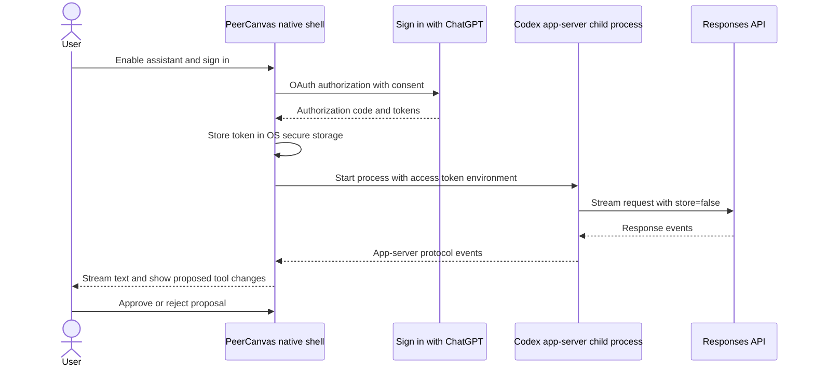

# Optional Codex and MCP integration

Research snapshot: 2026-11-07. No authentication flow, model call, or token exchange was performed.

## Finding

There is a documented path for an open-source, locally hosted application to request user consent to use that user's eligible ChatGPT plan for eligible Responses API requests. This is distinct from reusing a developer API key. It uses Sign in with ChatGPT OAuth; the OAuth access token is sent to the public Responses API or supplied to Codex app-server as an environment value. The user must consent, and account eligibility, limits, feature support, and terms apply.

The official documentation describes this path for open-source/local applications. It directs paid or remotely hosted apps to an interest/review process. The feature is a preview and has material limitations, so it is a viable candidate for PeerCanvas, not a production guarantee. Recheck official documentation and terms before registering the client or shipping it.

## Proposed process boundary

The renderer never reads the OAuth token. The native shell owns token refresh/storage and starts the child process with the token only for that process. Logs and diagnostics redact credentials and diagram content.

## Integration rules and limits

- Use the documented public Responses API path through the Codex app-server; do not call undocumented ChatGPT backend endpoints.
- Use the documented Sign in with ChatGPT OAuth flow, explicit user consent, correct host/client identifiers, and token refresh behavior.
- A host identifier is a stable opaque identifier for one installation/host, not a user identity or credential. Each physical computer needs its own host ID.
- The access token is a bearer credential. Store it in the OS credential store, limit its process exposure, redact it, and revoke/delete it on sign-out.
- For this preview flow, send streaming requests with storage disabled and include the required request context each time. Conversation state must be maintained/resumed locally through app-server, not assumed to exist in ChatGPT history.
- Do not assume hosted MCP, file search, Code Interpreter, image generation, tool search, or all Responses API parameters are supported by plan usage. Check the current limitations before selecting features.
- Treat provider usage errors and limits as ordinary recoverable states. Never present a model-list catalog as proof of entitlement; a successful inference response is the entitlement check.
- The app must remain usable with AI disabled or unauthenticated.
- Mutating AI operations are validated document commands and require preview plus explicit approval. The assistant is a proposer, not an authority.
- Never store client secrets, OAuth tokens, session IDs with secrets, or user ChatGPT data in the repository.

## Repository examples researched

These projects are references for protocol/process integration patterns. They are not official OpenAI SDKs, and PeerCanvas should not copy their app architecture.

| Project                                                   | Relevant pattern                                                                                                                    | Use for PeerCanvas                                                                                        |
| --------------------------------------------------------- | ----------------------------------------------------------------------------------------------------------------------------------- | --------------------------------------------------------------------------------------------------------- |
| [t3code](https://github.com/pingdotgg/t3code)             | TypeScript client/provider modules for Sign in with ChatGPT, token brokering, and Codex app-server; repository metadata reports MIT | Inspect for OAuth/app-server lifecycle and token refresh patterns; recheck current files before borrowing |
| [CodexMonitor](https://github.com/Dimillian/CodexMonitor) | Tauri/Rust desktop client controlling Codex app-server login/start operations; MIT                                                  | Closest desktop-shell reference for Rust/native process control                                           |
| [CodexGui](https://github.com/wieslawsoltes/CodexGui)     | Desktop GUI using Codex app-server and managed ChatGPT login; MIT                                                                   | Compare protocol client and account state handling                                                        |

The projects were inspected as public repositories on 2026-11-07. License metadata does not grant permission to copy code without following the relevant license and retaining notices. Their APIs and implementation may change.

## Implementation gate

WP-09 must verify current sign-in requirements, OAuth client registration, callback handling on Windows/macOS/Linux, refresh and sign-out, host ID behavior, account/model availability, preview limits, UI disclosures, and terms. No paid API calls were made during planning. A BYOK provider can be considered as an independent option, but it is not required for local editor use.

## Sources

- [OpenAI: Sign in with ChatGPT plan usage overview](https://developers.openai.com/siwc/token-sharing-open-source)
- [OpenAI: registration and sign-in](https://developers.openai.com/siwc/token-sharing-open-source/sign-in)
- [OpenAI: token reference](https://developers.openai.com/siwc/token-sharing-open-source/token-reference)
- [OpenAI: models and inference](https://developers.openai.com/siwc/token-sharing-open-source/models-and-inference)
- [OpenAI: Codex app-server](https://developers.openai.com/siwc/token-sharing-open-source/codex-app-server)
- [OpenAI: preview limitations](https://developers.openai.com/siwc/token-sharing-open-source/preview-limitations)
- [OpenAI: errors and recovery](https://developers.openai.com/siwc/token-sharing-open-source/errors-and-recovery)
