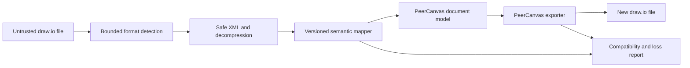

# draw.io compatibility plan

Status: planned adapter; no import/export code exists.

## Goal and boundary

PeerCanvas will exchange files with draw.io through an isolated import/export adapter. Compatibility means a declared, tested subset. The source format contains more than a flat list of shapes: XML graph structure, compressed representations, styles, geometry, pages, metadata, custom properties, and embedded SVG/assets can all carry behavior or meaning.

The adapter must not imply full draw.io parity. Its first release supports only features listed as **supported** in the compatibility matrix and reports all known losses before export or import completion.

## Proposed flow

## Initial compatibility matrix

The matrix is a test plan, not a claim of support. WP-06 fills actual supported versions and fixtures.

| Feature                                    | Initial status             | Acceptance evidence                                                        |
| ------------------------------------------ | -------------------------- | -------------------------------------------------------------------------- |
| Basic graph XML with standard cells        | Planned candidate          | Golden import fixture and semantic comparison                              |
| Compressed diagrams                        | Unknown                    | Real files from supported draw.io versions and bounded decompression tests |
| Multiple pages                             | Planned candidate          | Page count/order/name preserved in fixture                                 |
| Basic geometry and labels                  | Planned candidate          | Position, size, text and rotation assertions                               |
| Common connectors and arrow styles         | Planned candidate          | Endpoint, routing, label and style fixtures                                |
| Themes, advanced styles, custom properties | Partial/unknown            | Feature-specific fixture and explicit mapping                              |
| Embedded SVG/images                        | Restricted                 | Sanitization, size limits and license/provenance handling                  |
| Custom shapes, plugins, external URLs      | Unsupported until reviewed | Reject/report; never execute external content                              |
| Unknown XML elements or attributes         | Preserve where safe        | Bounded opaque extension survives round trip or loss is reported           |
| draw.io library/stencil definitions        | Unknown                    | Per-library license and schema review                                      |

## Safety and data handling

- Apply input-size, nesting-depth, decompression-ratio, element-count and time limits.
- Disable external entity resolution and network fetches.
- Sanitize embedded SVG and reject scripts, event handlers, external references, and unsafe data URLs.
- Parse into a temporary document. A failed import must not partially overwrite the active document.
- Write exports to a new file by default. Overwrite is explicit.
- Report unsupported/lossy content in a structured result and user-facing summary.
- Preserve original source fragments only when bounded and safe; preservation does not mean execution or display.
- Do not send imported document contents to a provider unless the user explicitly shares them.

## Test strategy

WP-06 creates a versioned corpus with provenance and license notes. Each fixture must record its source, source version, expected features, and whether redistribution is permitted. Tests compare semantic fields, not XML whitespace or attribute order.

Required cases: known-good uncompressed XML, compressed XML, multiple pages, labels/connectors, unsupported/custom content, malformed XML, entity expansion, oversized input, decompression bomb, external resource, malicious SVG, interrupted write, and round trip.

## References

- [draw.io file format notes](https://github.com/jgraph/drawio/wiki/File-Format)
- [draw.io repository and licensing notes](https://github.com/jgraph/drawio)
- [OWASP XML Security Cheat Sheet](https://cheatsheetseries.owasp.org/cheatsheets/XML_External_Entity_Prevention_Cheat_Sheet.html)
