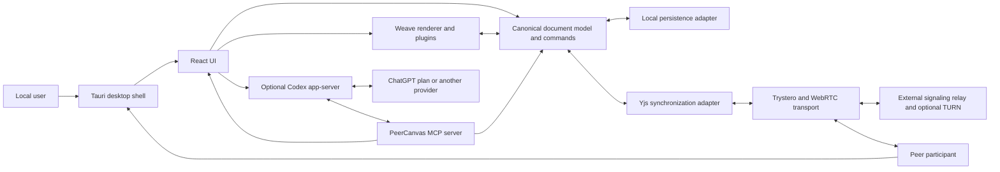
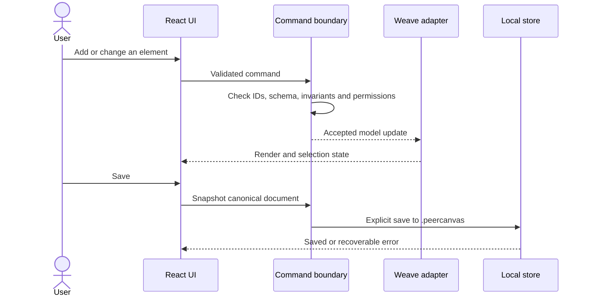

# PeerCanvas architecture overview

Status: the S0 compatibility probe and S1–S3 local-editor capabilities are delivered; WP-07 transport implementation is in progress, without share/join UI. Minimum OS floors and real cross-device WebRTC workflows remain unverified.

## Constraints and verified baseline

- Desktop shell: Tauri 2.12.x candidate with Rust.
- UI: React 18.3.1, TypeScript, and Vite 8. React 18 is retained because the selected Weave renderer's published peer dependency range excludes React 19.
- Canvas engine: Weave.js 5.7.1 with its React renderer and Konva integration; selectively reuse canvas UI components from the official `weavejs-frontend` example.
- Document collaboration: host-sequenced Yjs state behind a replaceable transport adapter; initial signaling uses Trystero 0.26 MQTT-over-WebSocket and WebRTC. Public Google/Cloudflare STUN defaults are in use; no TURN provider is selected.
- Platforms: Windows, macOS, Linux. The S0 probe measured the native WebViews on the runner images in the [platform matrix](../support/platform-matrix.md); minimum OS support floors and full product behavior remain open.
- AI candidate: optional Codex app-server process using Sign in with ChatGPT for eligible open-source/local-app plan usage, subject to preview terms and registration.
- Chat UI: adapt the shadcn chatbot template's React components and interaction patterns while retaining the Tauri/Vite shell and PeerCanvas provider boundary; do not adopt its Next.js routes or Vercel AI SDK backend.

The bounded test-only WP-01 probe passed native launch, rendering, selection, transforms, connector rendering, and one in-memory Weave-store-backed edit on the runner images in the [platform matrix](../support/platform-matrix.md). It remains separate from production workflows and does not establish minimum OS floors, product persistence, or WebRTC behavior. The delivered editor and persistence flows have separate evidence in the current [session handoff](../handoff/START_HERE.md) and [ADR-0003](decisions/ADR-0003-local-persistence.md).

## Logical component view

The separately invoked [UI demonstration](../development/ui-mock.md) consumes the pure shared `src/document` core and derives an in-memory Weave projection. Its services simulate file lifecycle, interchange, collaboration, and assistant/MCP outcomes. It does not add these services to the normal application, select a durable backend, or establish production/native capability acceptance. The frozen shared pure interface is recorded in [the shared document contract](shared-document-contract.md).



The model command boundary is the security and consistency boundary for UI, peer, import, AI, and MCP mutations. Render state, selection, presence, and conversation state are not independent copies of the document.

## Component responsibilities

| Component                  | Responsibility                                                                                             | Must not own                                             |
| -------------------------- | ---------------------------------------------------------------------------------------------------------- | -------------------------------------------------------- |
| Tauri shell                | Window lifecycle, native dialogs, secure storage, deep links, controlled child processes                   | Diagram semantics                                        |
| React UI                   | Toolbars, panels, session controls, chat, previews, errors, accessibility                                  | A separate mutable diagram document                      |
| Weave adapter              | Canvas rendering, selection, transforms, connectors, plugins, history integration where compatible         | Authorization or durable storage policy                  |
| Canonical document model   | Versioned pages/layers/nodes/edges/styles; command validation; migrations and stable IDs                   | Provider tokens or transport credentials                 |
| Persistence adapter        | Explicit save/open of user-managed `.peercanvas` files, migration, backups, and recovery                   | Collaboration policy or implicit autosave                |
| Yjs adapter                | Transient session synchronization, initial sync and awareness; accepted changes use the canonical boundary | Trusting raw peer input or owning durable document state |
| Transport adapter          | Peer discovery, signaling and WebRTC lifecycle                                                             | Claiming that all peers can connect directly             |
| Invitation/session service | Secret generation, expiry, admission, roles, revocation and session lifecycle                              | Centralized identity in the initial design               |
| Codex app-server adapter   | Optional conversations, streaming, cancellation and provider lifecycle                                     | Direct access to unsafe arbitrary model mutations        |
| MCP server                 | Versioned, bounded document tools that use the model command boundary                                      | Bypassing approval or role enforcement                   |

## Canonical document model

Schema-v2 top-level shape:

```text
Document
  schemaVersion
  documentId
  metadata
  pages[]
    pageId
    name
    layers[]
      layerId
      name
      nodes[]
      connections[]
  styles
  libraryReferences[]
  sourceCompatibility
```

Each node or connection has a stable ID, a declared type, and validated properties. A catalog-backed node stores its stable shape ID and asset version. `sourceCompatibility` can store only bounded, inert draw.io fragments; the importer never renders them. Migration and bounds are recorded in [ADR-0007](decisions/ADR-0007-document-schema-v2-compatibility.md). Imported extension data remains untrusted.

## Core data flows

### Local edit and save



### Peer update

Peer edits arrive as commands. The host serializes proposals through `executeCommand`; it rebases only stale proposals whose affected IDs do not overlap newer accepted commands and rejects the rest with the current snapshot. Only the host writes accepted commits to transient Yjs state, and peers replay those commits through the same validator. Commits carry their origin so each participant can keep undo/redo history for their own commands. Connection/retry status and ephemeral awareness remain separate from saved document state. The host's `.peercanvas` file changes only through explicit Save; transport loss must not silently save, discard, delete, or replace the last successful save. Invitation, admission, and role policy remain WP-08.

### AI-proposed change

The provider returns a proposed operation list. The MCP/assistant adapter parses and validates the list, presents a diff-like preview, and waits for the user. Approval submits normal model commands; denial or cancellation leaves the document unchanged. The user-visible history records approved operations and their origin without retaining credentials.

## Decisions and boundaries

- Tauri owns native integration; React runs inside the system WebView. Do not assume Chromium behavior on every OS.
- The renderer is a replaceable adapter around the canonical model. Reuse Weave capabilities where verified rather than rebuilding them.
- The official `weavejs-frontend` is a source for selective UI adaptation, not an application runtime dependency. Preserve Apache-2.0 notices for any code reused.
- The shadcn chatbot template is a source for chat UI adaptation, not a provider/backend choice. Preserve its MIT notice for any code reused.
- Local-only functionality has no network dependency. Collaboration and AI are optional adapters.
- P2P does not mean zero infrastructure. Signaling may use public or configured relays; NAT/firewall conditions may require TURN.
- The invitation secret is a bearer capability. A link alone does not establish a person's identity or guarantee that an admitted peer cannot copy data.
- OpenAI access tokens remain in the native process/token store and are passed only to the Codex child process as required by the documented app-server integration. No token is exposed to the renderer or logs.
- No installer format, signing, update mechanism, network relay operator, or AI provider is fixed by this baseline. The local document file format is selected in ADR-0003.

## Validation gates

| Gate                | Required evidence                                                                                                                                 | Owner package |
| ------------------- | ------------------------------------------------------------------------------------------------------------------------------------------------- | ------------- |
| Tauri/Weave         | [S0 native render/select/transform/connector/edit matrix and upstream notices](../support/platform-matrix.md); product adapter validation remains | WP-01         |
| Persistence         | save/open, migration, interrupted write and recovery experiments on each OS                                                                       | WP-03         |
| draw.io             | safe parser, golden fixtures, round-trip subset, loss report                                                                                      | WP-06         |
| P2P                 | LAN/NAT/TURN matrix, sync convergence, host disconnect and reconnect                                                                              | WP-07/WP-08   |
| Invitation security | entropy, deep-link handling, logs, expiry, admission, role enforcement and revocation tests                                                       | WP-08         |
| Codex/MCP           | current auth eligibility/terms, app-server protocol, token boundary, approval and denial tests                                                    | WP-09/WP-10   |
| Release             | CI plus real OS/WebView smoke checklist, licenses, accessibility and recovery                                                                     | WP-11         |

## Sources

- [Weave.js 5.7.1 release](https://github.com/InditexTech/weavejs/releases/tag/5.7.1)
- [Weave React package metadata](https://github.com/InditexTech/weavejs/blob/5.7.1/code/packages/react/package.json)
- [Weave setup guide](https://github.com/InditexTech/weavejs/blob/5.7.1/docs/src/modules/sdk/pages/setup.adoc)
- [weavejs-frontend](https://github.com/InditexTech/weavejs-frontend)
- [shadcn chatbot template](https://github.com/shadcn-ui/chatbot-template)
- [Tauri WebView versions](https://v2.tauri.app/reference/webview-versions/)
- [Tauri Vite setup](https://v2.tauri.app/start/frontend/vite/)
- [Yjs document updates](https://docs.yjs.dev/api/document-updates)
- [Trystero signaling strategies](https://trystero.dev/docs/signaling-strategies/)
- [Trystero connections](https://trystero.dev/docs/connections/)
