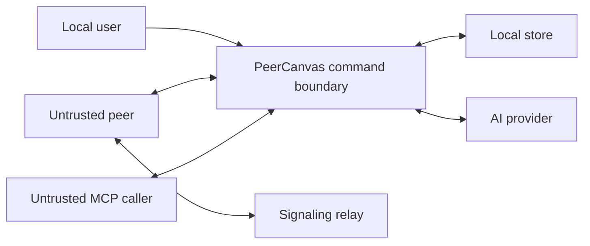

# Peer sharing threat model

Status: initial review baseline. The protocol is not implemented and this document does not claim security certification.

## Assets

- Local diagram contents and imported files.
- Invitation session secret and session identifier.
- OAuth credentials for an optional AI provider.
- Participant identity/role and presence information.
- Local snapshots, backups, logs, and crash reports.
- Catalog assets and their provenance.

## Trust boundaries and actors

The local user and local document store are trusted only to the extent the host OS account is trusted. Peer participants, relay/signaling services, imported files, AI providers, and MCP clients are untrusted. WebRTC encrypts transport between peers, but transport encryption does not establish a human identity or make a peer's edits safe.

## Main threats and controls

| Threat                                           | Impact                                               | Required controls                                                                                                                                                                                            |
| ------------------------------------------------ | ---------------------------------------------------- | ------------------------------------------------------------------------------------------------------------------------------------------------------------------------------------------------------------ |
| Leaked invite URL                                | Unauthorized join and document disclosure            | 256-bit cryptographic secret; place secret in URL fragment or equivalent local handoff so it is not sent in ordinary HTTP requests; expiry; optional host approval; redact logs and crash reports            |
| Secret copied by an authorized participant       | Access continues until revocation                    | Host can revoke future access and close session; explain that already received document data cannot be recalled                                                                                              |
| Viewer bypasses hidden controls                  | Unauthorized changes                                 | Enforce role on every model command, imported/remote update, and MCP mutation; negative authorization tests                                                                                                  |
| Malicious peer sends malformed Yjs/model payload | Crash, resource exhaustion, invalid state            | Bound message/element sizes; validate resulting model invariants; isolate parsing; rate limits and safe disconnect                                                                                           |
| Public relay observes metadata                   | Reveals timing, connection and room activity         | Signaling uses three replaceable public MQTT-over-WebSocket endpoints; minimize identifiers, keep document changes on WebRTC data channels, and disclose relay metadata/availability before invitations ship |
| NAT/firewall prevents direct WebRTC              | Connection failure                                   | Surface state and retry; test LAN/STUN/TURN; document any TURN service and its credentials/cost                                                                                                              |
| Malicious XML/SVG import                         | Code execution, network fetch, memory/CPU exhaustion | Disable XML external entities; no external fetch; sanitize SVG; bound size/depth/decompression; parse to temporary state                                                                                     |
| AI prompt injection or invalid tool call         | Unintended changes or data disclosure                | Explicit context sharing; untrusted-proposer model; structured schemas; bounded reads; preview; per-operation approval; command-boundary validation                                                          |
| OAuth token appears in renderer/logs             | Account misuse                                       | Native-only secret storage, child-process environment passing, redaction, no analytics, sign-out revocation and deletion                                                                                     |
| Local file corruption or interrupted write       | Data loss                                            | Atomic save/checkpoint, last-known-good snapshot, recoverable migration and non-destructive error path                                                                                                       |

## Invitation protocol questions

Proposed shape: random session ID plus at least 256 bits of secret from the platform cryptographic RNG; secret in the URL fragment, never a query parameter; host admission; explicit viewer/editor role; expiry and revoke. Derive room keys using a reviewed cryptographic construction rather than concatenating user text. Do not assume a secret shared room name alone provides authorization or forward secrecy.

Before implementation, decide:

1. Which authenticated encryption/key-derivation protocol protects document data from signaling infrastructure?
2. Can the host validate each update before applying it, given Yjs update application semantics?
3. How is read-only permission enforced against a peer that can transmit protocol messages directly?
4. The initial signaling strategy uses public EMQX, HiveMQ, and Mosquitto MQTT brokers; Trystero's default STUN uses public Google and Cloudflare endpoints. Which deployment policy replaces or retains these services, what relay metadata is visible, and is TURN needed? No TURN provider or credentials are selected.
5. What is the session behavior after host exit, suspension, or network change?
6. What does revocation guarantee for future updates, and what content remains available to an already connected peer?

## Logging and incident response

Do not log full invitation URLs, secrets, document payloads, OAuth credentials, or full AI prompts by default. Diagnostics should use opaque local event IDs and redact sensitive fields. Security reports should use GitHub's private vulnerability reporting when it is enabled; otherwise use the contact route in SECURITY.md.

## Release gate

WP-08 and WP-11 require a reviewed threat model, protocol tests, secret/log scans, malicious import fixtures, role enforcement tests, recovery tests, and explicit documentation of relay/TURN and revocation limits.
